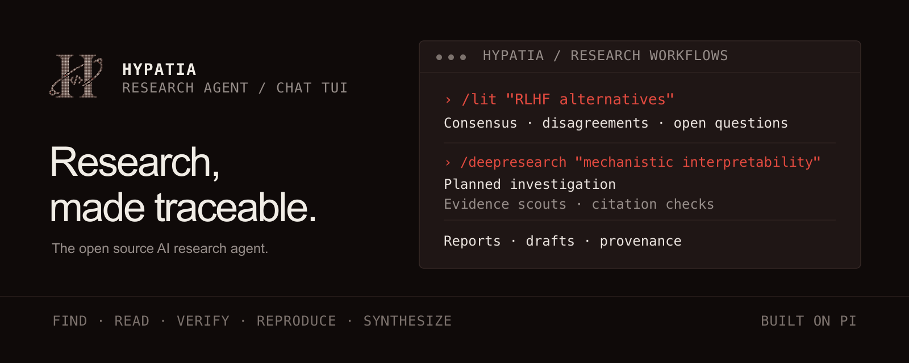
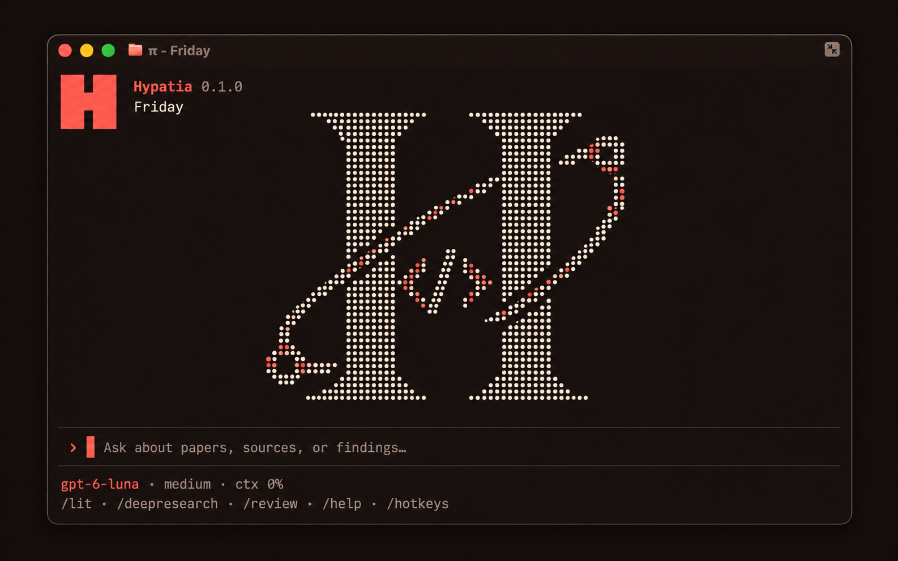

<p align="center">
  <a href="https://github.com/TQuang122/hypatia">
    
  </a>
</p>
<p align="center">Find answers. Trace every source.</p>
<p align="center">
  <a href="https://tquang122.github.io/hypatia/"></a>
  <a href="https://github.com/TQuang122/hypatia/blob/main/LICENSE"></a>
  <a href="https://deepwiki.com/TQuang122/hypatia"></a>
</p>

## Quick start

Requires Node.js 22.22 or newer.

```bash
npm install -g @tquang122/hypatia
hypatia setup
hypatia "what do we know about scaling laws"
```

For standalone installers, pinned versions, or skills-only installs, see the [installation guide](https://tquang122.github.io/hypatia/docs/getting-started/installation/). The [setup guide](https://tquang122.github.io/hypatia/docs/getting-started/setup/) covers provider sign-in, local models, and editors.

## Use

```bash
hypatia lit "RLHF alternatives"
hypatia deepresearch "mechanistic interpretability"
hypatia --codemode deepresearch "compare mechanistic interpretability methods"
```

`--codemode` adds Pi Codemode for one session while keeping the default tools. It is off by default. To keep it available in every session, add `"defaultTools": ["+codemode"]` to `~/.hypatia/agent/settings.json`.

| Workflow | What it does |
| --- | --- |
| `/deepresearch <topic>` | Planned investigation with parallel evidence scouts and citation checks |
| `/lit <topic or lab>` | Literature review: consensus, disagreements, open questions |
| `/review <paper or draft>` | Critique with severity levels and a revision plan |
| `/audit <paper>` | Paper claims compared with its public code |
| `/replicate <paper>` | Replication plan; runs only after you choose an environment |
| `/recipe <task>` | Ranked ML training recipes with datasets and code |
| `/compare <topic>` | Source comparison matrix |
| `/draft <topic>` | Paper-style draft from research findings |
| `/idea <goal>` | Generate bounded research ideas with Hypatia-native Idea Forge |
| `/autoresearch <idea>` | Bounded experiment loop against a benchmark |
| `/summarize <source>` | Summary of a paper, repository, or PDF |
| `/sources` | Browse citations from the latest answer; open or copy source URLs |

Results are saved to `outputs/` (drafts to `papers/`). `/lit`, `/deepresearch`, and `/recipe` also write a provenance file listing the sources used and what was verified.

Run `/outputs` in chat to browse **Reports**, **Provenance**, **Drafts**, and **Other artifacts**, newest first within each group. Choosing a Markdown report opens it directly in the TUI. Use arrows/Page Up/Page Down to scroll, `/` or `Ctrl+F` to search, `n`/`N` for the next/previous matching row, `p` for the same-name report/provenance beside the current file, and `c` to copy its absolute path. `Esc` returns to the file list. Text previews are limited to 2 MiB; PDFs and larger files offer path copying and an explicit **Read in chat** action. Viewing and copying preserve the composer; **Read in chat** (or `r` in the reader) prefills a quoted file path for you to review and submit.

Use `/compare-provenance` in the chat TUI to compare the recorded verification and source-coverage fields from two completed runs. It compares metadata only and does not rank the runs.

Use `/sources` to inspect URLs and DOI/arXiv identifiers in the latest assistant answer. Verification status appears only when the answer states it explicitly. In long fullscreen sessions, Hypatia also suggests Pi's transcript search shortcut; short terminals compact the header and hide the welcome art or idle tip to preserve reading space.

## Persistent experiments

Use `/autoresearch <idea>` or `/experiments create <goal>` to prepare an approved, bounded benchmark run. Hypatia records observed metrics, code snapshots, logs, and provenance; runs can pause and resume. Experiment trees compare related candidates while keeping their work separate from your checkout.

The [AutoResearch guide](https://tquang122.github.io/hypatia/docs/workflows/autoresearch/) covers benchmark contracts, metric formats, budgets, supported platforms, and experiment trees. See its [independent review gates](https://tquang122.github.io/hypatia/docs/workflows/autoresearch/#independent-review-gates) section for critic and auditor checks.

### Idea Forge generation

Use `/idea <research goal>` for a bounded proposal from Hypatia's native Idea Forge. Proposals and citations remain unverified until you check them; benchmark execution requires a separate approval. Read about [Idea Forge generation](https://tquang122.github.io/hypatia/docs/workflows/autoresearch/#idea-forge-generation) for model panels, limits, and saved receipts.

## Chat TUI

Hypatia opens in fullscreen with the Graphite theme. Use `/settings` to change the layout or theme, and `/reload` to apply theme changes.

<p align="center">
  
  <br />
  <em>Research workflows in Hypatia's fullscreen chat.</em>
</p>

- **Input:** `Enter` sends, `Shift+Enter` adds a line, and `Alt+Enter` queues a follow-up. Paste images with the configured shortcut; `/hotkeys` lists bindings.
- **Activity:** The footer shows the active model and status. Press `Ctrl+O` for tool details or `F2` to review warnings.
- **Research:** Use `/outputs` to browse reports and provenance. Markdown previews support scrolling and search; paper and code search results expand with `Ctrl+O`.

## Per-role model routing

Active subagent model and progress appear in the footer only while agents are running.

Research agents inherit the main model unless you configure routes. Use `/model-routes` in the TUI or `hypatia model routes` in a shell to set a primary model and ordered launch fallbacks; `hypatia model routes --json` prints the effective configuration. See [Subagent model overrides](https://tquang122.github.io/hypatia/docs/getting-started/configuration/#subagent-model-overrides) for JSON settings, precedence, migration, fallback behavior, and usage reporting.

## Evaluation

The repository includes the fixed research eval plus score adapters for ScholarQA-CS2/AstaBench, DeepResearch Bench FACT, and SciCoQA. The runner accepts local question manifests; score adapters consume local outputs from the official evaluators and do not fetch gated data or make judge calls. See [`evals/README.md`](evals/README.md) for input schemas, pinned sources, and scoring commands.

## Sources

Hypatia searches alphaXiv, Semantic Scholar, OpenAlex, arXiv, PubMed, Europe PMC, bioRxiv, medRxiv, Crossref, CORE, DOAB, public GitHub code, the web, and Hugging Face, recovers legal open-access copies for paywalled DOIs, and reads local PDFs and documents. Free `OPENALEX_API_KEY`, `SEMANTIC_SCHOLAR_API_KEY`, and `CORE_API_KEY` keys avoid the shared rate limits; `UNPAYWALL_EMAIL` enables the Unpaywall step of OA recovery. It runs on stock [Pi](https://github.com/earendil-works/pi) with five research agents: evidence-scout, scribe, auditor, critic, and reviser.

## Telemetry

Hypatia sends anonymous usage data to PostHog only if you opt in with `HYPATIA_TELEMETRY=1` and your own `HYPATIA_POSTHOG_KEY`: commands, workflows, tools, models, token counts, and errors with their messages and stack traces (your home folder shown as `~`). It never sends prompts, model output, paper content, or tool arguments. Telemetry is off by default. [What is sent](https://tquang122.github.io/hypatia/docs/getting-started/configuration/#telemetry)

## Contributing

```bash
git clone https://github.com/TQuang122/hypatia.git
cd hypatia
npm install
npm test
```

See [CONTRIBUTING.md](CONTRIBUTING.md).

[Docs](https://tquang122.github.io/hypatia/docs/) · [Release notes](RELEASES.md) · [MIT License](LICENSE)
