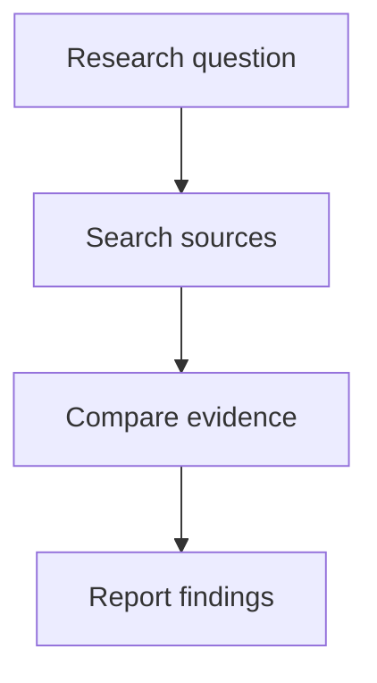

# Research Diagrams

Turn supplied or verified information into a diagram without adding claims. This skill guides diagram design; it does not discover sources, verify research claims, or change Pi's renderer.

## Choose the output medium

### Chat transcript

Hypatia uses Pi's Mermaid-to-terminal renderer. It can leave a Mermaid block as source when the diagram is invalid or wider than the available terminal, so optimize for a narrow text display:

- Prefer a plain `flowchart TD` with a small number of nodes and short, single-line labels.
- Use simple node shapes and direct edges. Put a complete edge, including any label, on one line.
- Avoid HTML line breaks, long sentences inside nodes, styling directives, and dense subgraphs.
- Split a dense diagram into smaller views. If it still will not fit, give a compact list or table instead of a large Mermaid block.
- Do not claim the diagram rendered unless the transcript shows the rendered result. The `mmdc` renderer can check Mermaid syntax for files, but it does not prove that Pi can fit the diagram in this terminal.

Example:

### Saved research artifacts

- Add a Mermaid diagram only when it communicates a supported relationship more clearly than prose or a table.
- Choose the type to match the structure: flowchart for steps or branching, sequence diagram for ordered interactions, state diagram for state changes, and entity/class diagrams for documented relationships.
- Keep a dense model readable by splitting it into views. Do not shrink meaning into cryptic labels just to fit more nodes.
- Give the diagram a descriptive caption. Keep supporting citations and source references in the surrounding artifact so readers can trace material nodes and relationships.
- Create a separate `.mmd`, SVG, or PNG only when the user or active workflow requests that artifact.

## Preserve evidence and uncertainty

- Treat the supplied research notes, source excerpts, or verified model as the source of truth. Do not redo discovery when another workflow has already supplied its findings.
- Include only nodes and relationships supported by that input. Omit missing details or mark them as unknown; never invent a component, causal link, mechanism, or result to make the diagram look complete.
- Preserve qualifications. Do not draw association as causation. If an inferred or proposed relationship must be shown, label it explicitly and distinguish it from established findings.
- For research drafts, leave inline source-citation placement to the workflow's auditor when that workflow assigns citations to a later stage; preserve source IDs or references in the caption/context it receives.
- Do not use a diagram as decoration or as a substitute for explaining a consequential uncertainty.

## Check before returning

1. Confirm that the diagram answers the user's question and uses the right visual form.
2. Read every node and edge against the supplied evidence; preserve uncertainty and directionality.
3. Check Mermaid syntax, quoting labels that contain punctuation or special characters, and keeping each edge on one line.
4. For a chat diagram, favor compact `flowchart TD` syntax and avoid promising a render when terminal fit has not been checked.
5. For a saved artifact, use an already available local `mmdc` only when validation or export is requested. Do not install packages or send research content to a hosted renderer just to produce a preview.
